<!-- ====================================================== -->
<!--                       HEADER                           -->
<!-- ====================================================== -->

  

<h2 align="center">
  👋 Hi, I'm Hanan!
</h2>

  <b>Communication & Information Engineering Student</b>

  ☁️ Cloud Computing
  &nbsp; • &nbsp;
  💻 Software Engineering
  &nbsp; • &nbsp;
  🌐 Computer Networks

  🌱 Open-Source Contributions
  &nbsp; • &nbsp;
  ⚙️ Systems & Infrastructure

 

<!-- ====================================================== -->
<!--                    TYPING ANIMATION                    -->
<!-- ====================================================== -->

  

 

---

<!-- ====================================================== -->
<!--                       ABOUT ME                         -->
<!-- ====================================================== -->

<h2 align="center">✨ About Me</h2>

  I'm a <b>Communication & Information Engineering student</b>
  building a technical foundation in <b>cloud computing,
  software engineering, and computer networks</b>.

  I'm especially interested in how software and infrastructure
  work together, and I learn by building projects and contributing
  to real-world open-source codebases.

---

<!-- ====================================================== -->
<!--                    MY TECH STACK                       -->
<!-- ====================================================== -->
<h2 align="center">🛠️ My Tech Stack</h2>

  <i>Technologies I'm learning, building with, and exploring</i>

 

<!-- Programming -->

  

<!-- Web -->

  

<!-- Cloud -->

  
  

<!-- AI -->

<!-- Networking & Cybersecurity -->

<!-- Engineering -->

  

<!-- ====================================================== -->
<!--                  CURRENTLY LEARNING                    -->
<!-- ====================================================== -->

<h2 align="center">🌱 Currently Learning</h2>

<table align="center">
  <tr>
    <td align="center" width="200">
      <h3>☁️ Cloud Computing</h3>
      Cloud Fundamentals 
      AWS & Cloud Services 
      Virtualization & Infrastructure
    </td>
    <td align="center" width="200">
      <h3>🌐 Networking</h3>
      Computer Networks 
      Network Protocols 
      Network Architecture
    </td>
    <td align="center" width="200">
      <h3>🤖 Machine Learning</h3>
      ML Fundamentals 
      Supervised & Unsupervised Learning 
      Model Training & Evaluation
    </td>
    <td align="center" width="200">
      <h3>🧠 AI</h3>
      AI Fundamentals 
      AI Applications 
      Intelligent Systems
    </td>
  </tr>
</table>

---

---

<!-- ====================================================== -->
<!--                     OPEN SOURCE                        -->
<!-- ====================================================== -->

<h2 align="center">🌍 Open-Source Contributions</h2>

  <b>3 merged pull requests</b> across established open-source projects,
  with another contribution currently under review.

- [PR #270 — Recusal (Merged)](https://github.com/philpaz/recusal/pull/270): Improved Pydantic AI adapter type annotations and compatibility with strict type-checking.
- [PR #9 — Good First Issues for CNCF Projects (Merged)](https://github.com/kavirakesh14/good-first-issues-for-cncf-projects/pull/9): Added an AI Native filter while preserving the existing issue data.
- [PR #11 — FastaFrames (Merged)](https://github.com/pgarrett-scripps/FastaFrames/pull/11): Added tests for non-UniProt FASTA header formats.
- [PR #50129 — SGLang / AMD Nightly CI (In Progress)](https://github.com/sgl-project/sglang/pull/50129): Improved workflow handling so unexpected skipped AMD nightly jobs are detected.

  <a href="https://github.com/hananbahi527?tab=repositories">Explore my repositories</a>
  &nbsp; • &nbsp;
  <a href="https://github.com/hananbahi527?tab=pullrequests">View my pull requests</a>

---

<!-- ====================================================== -->
<!--                    GITHUB STATS                        -->
<!-- ====================================================== -->

<!-- ====================================================== -->
<!--                    GITHUB ACTIVITY                    -->
<!-- ====================================================== -->

## 📊 GitHub Activity

  

  
  

  

---

<!-- ====================================================== -->
<!--                     CONNECT                            -->
<!-- ====================================================== -->

<h2 align="center">🌐 Connect With Me</h2>

 

<!-- ====================================================== -->
<!--                       FOOTER                           -->
<!-- ====================================================== -->

  

